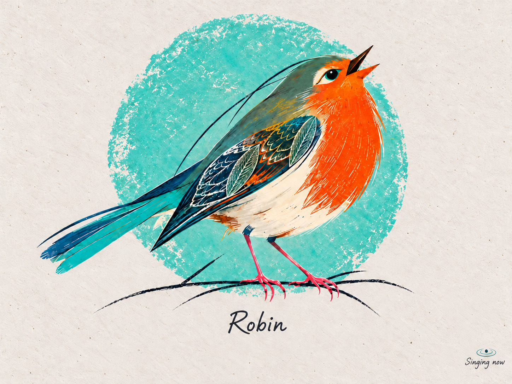
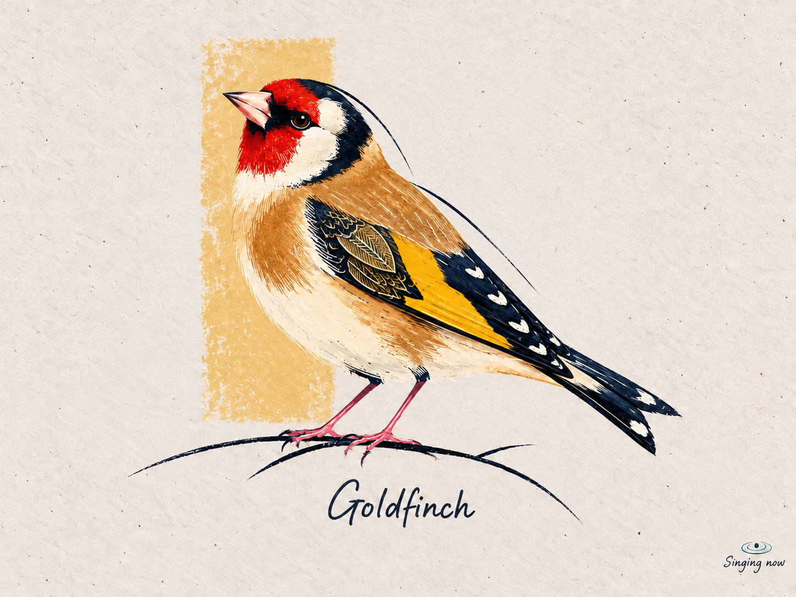
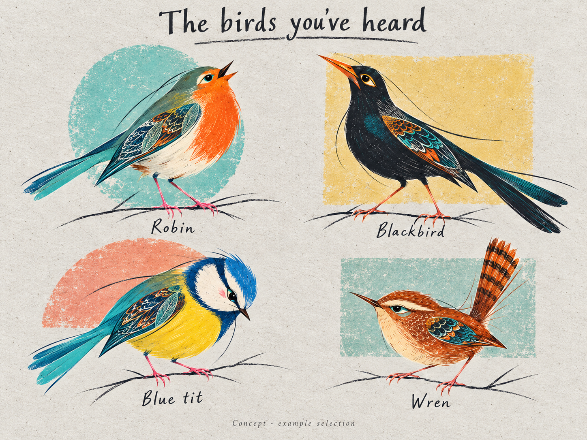
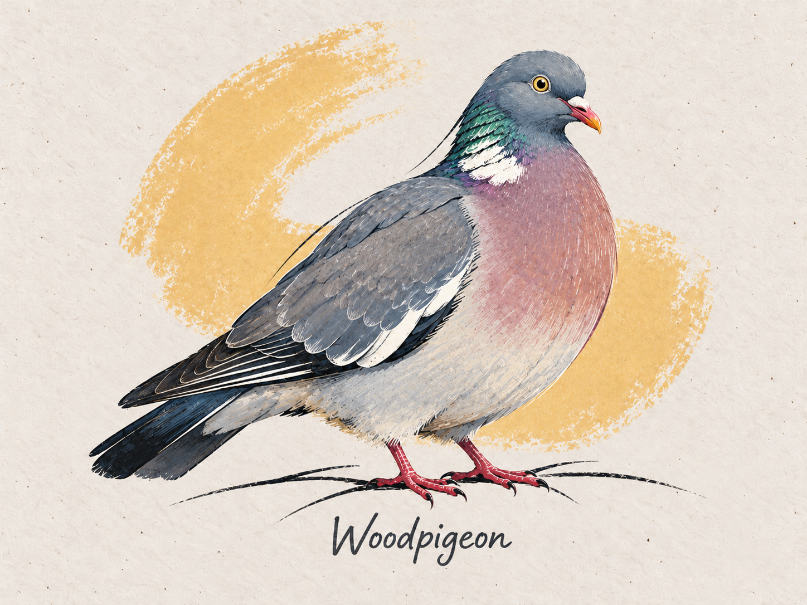

# Birdsong final art system

Revised 21 October 2026 to include the user-endorsed Woodpigeon v2 refinement alongside the five original bird designs. Preserve the shared graphic drawing language while leaving composition, character and background choices open. This governs the finished illustration. The approved Robin sequence remains the separate animation benchmark.

## The defining combination

**Recognisable birds with individual character, rich pigment, expressive linework and a carefully drawn finish on ivory paper.**

The shared principles are species identity, material richness, considered detail and a bird-led visual hierarchy. Pose, degree of stylisation, palette relationships, composition, ornament and abstract background treatment remain open. Existing examples are reference points, not a closed menu. Each new concept should have room to contribute something the collection has not seen before; surprise is welcome when it strengthens the picture, without a novelty quota.

These are graphic bird portraits with painterly surfaces. Watercolour supplies translucency and soft transitions; stronger pigment supplies the silhouette and colour masses. Fine pencil and ink supply the face, feather direction and ornamental passages. Asking only for a “watercolour bird” loses the structure and detail; asking only for a “folk-art bird” risks excessive pattern and generic anatomy.

The charm should be visible in posture and mark-making before any caption is read. No joke or fun-fact text.

## Visual reference library

These three original image files contain all five existing designs: **Robin, Goldfinch, Blue tit, Blackbird and Wren**. The images are bundled with the skill so the reference library remains usable independently of this conversation.

When beginning new artwork, open these files with an image-viewing tool to inspect the pixels; reading this Markdown or its captions does not load the visual references. If already visible in the current context, use that inspection. Supply the relevant original images through the image-generation tool's supported reference-image mechanism, rather than only mentioning their filenames in the prompt. Record which images were used. Keep verified anatomical references for the new species separate from these artistic references.

Also inspect the Woodpigeon comparison below: it records a small but important rendering correction endorsed by the user. V1 is a comparison only; use v2 when supplying this refinement as a generation reference. Study the handling of paper, pigment, line and detail. These compositions and motifs are examples, not templates or limits for new species. No matching pose, backdrop, feather motif or palette is required.

### Robin



[Open the original Robin image](../assets/style/robin-source.png). Reference for energetic pigment and linework.

### Goldfinch



[Open the original Goldfinch image](../assets/style/goldfinch-source.png). Reference for detailed finish and restrained expression.

### Blue tit, Blackbird and Wren in the existing collection



[Open the original collection sheet](../assets/style/existing-birds.png). **Robin: upper left. Blackbird: upper right. Blue tit: lower left. Wren: lower right.** The sheet preserves the original designs together, showing variation within the same artistic language.

### Woodpigeon: a small shift toward the original graphic language

The user preferred v2 and asked for the difference to guide future species. This is a calibration of drawing treatment alongside the originals; it does not replace them or prescribe a pigeon-shaped template.



[Woodpigeon v1 — earlier treatment, comparison only](../assets/style/refinements/woodpigeon-v1.png).


[Woodpigeon v2 — preferred refinement](../assets/style/refinements/woodpigeon-v2.png).

| Visible change | Transferable direction |
|---|---|
| Overlapping coverts read as clearer scalloped shapes; flight feathers form longer dark planes | Organise plumage into deliberately shaped pigment masses and rhythmic feather groups |
| Deeper petrol/navy separations distinguish wing, neck and tail; selective pale edges clarify overlaps | Use contrast to explain structure, varying dark and pale accents to suit each species |
| Cream/gold lines and directional scratches sit within clearer larger shapes | Retain rich detail while making its organisation legible; adding more tiny marks alone does not add character |
| Selected long and broken contours feel more decisive | Let line weight, taper and rhythm carry expression without outlining every edge equally |

The pose, broad body, small head, identifying markings, paper, support, name and ochre backdrop remain largely the same. The improvement is mainly in graphic organisation, not additional anatomical exaggeration. Fine surface marks remain plentiful: this is not a general instruction to remove detail or flatten everything into vector shapes.

For other species, transfer the relationship between clear masses, feather rhythm and selective precision. Gold edging, scallops, wing ornament, petrol shading and the ochre arc are choices in this image, not required ingredients. Do not imitate those colours where they obscure identifying plumage. Pale birds can achieve comparable clarity through paper reserves and restrained edges.

### How to use the references

| Reference | Use it for | Do not copy automatically |
|---|---|---|
| [Robin](../assets/style/robin-source.png) | Saturated pigment, energetic contour, detailed wing, paper, name and tiny status placement | Long tail, lifted face, orange breast, turquoise circle |
| [Goldfinch](../assets/style/goldfinch-source.png) | Restrained character, crisp detailed finish, quieter body passages, economical backdrop | Red mask, yellow wing stripe or its upright pose |
| [Existing collection](../assets/style/existing-birds.png) | Blue tit head tilt, Wren tail gesture, Blackbird elongated stance; variation within a family | A universal eye treatment, branch pose or identical ornamental wing badge |
| [Woodpigeon v2](../assets/style/refinements/woodpigeon-v2.png) | Clear pigment masses, rhythmic feather groups, selective edge contrast; slight stylisation through drawing | Gold scallops, ochre arc, pigeon proportions or a mandatory wing motif |

The originals are the final-art detail standard. Animation reconstructions may be softer and should not lower that standard. The Goldfinch demonstrates restraint and a rich finish; the other birds show more expressive possibilities. Use the collection to judge craft and coherence, without treating any one bird as a ceiling on invention. This does not change the existing pictures.

## Shared visual language

### Form and composition

The bird leads a landscape 4:3 display composition. Its scale, facing, placement, body gesture and use of exposed paper are open: close or spacious, upright or sweeping, centred or deliberately off-centre. Character may come from several coordinated choices in posture, gaze, contour and proportion. A clear emphasis is a useful starting point, not a quota. Keep the silhouette recognisable.

Preserve species-specific bill, head, wing, tail and foot structure. Choose sex, age and plumage deliberately where they affect the design. Use verified species references for those decisions, separately from artistic references. A posture is an illustration choice, not a claim about an animal's personality.

Keep the existing range of bold silhouettes and fine projecting lines, without treating stylised source proportions as biological measurements. Do not simultaneously enlarge eyes, chest, head, feet and tail. In particular, do not inflate the Robin's breast further.

### Material and edges

Warm ivory, cold-pressed paper remains visible. Use soft transparent underpainting alongside rich, gouache-like colour, broken dry-print grain and directional pencil marks. The final surface should feel worked by hand, with visible paper tooth rather than a uniform noise filter.

The existing drawings suggest an open vocabulary of marks. These are examples, not mandatory ingredients in every portrait:

- Short tapered marks follow body and feather direction.
- Fine scallops, shafts and leaf-vein-like engraving make a selected feather passage intricate.
- A few long, economical navy contours flow beyond an edge of the body or perch.

Keep the face and selected feather boundaries crisp. Allow softer transitions, broken pigment and quieter passages elsewhere. Avoid equally sharp outlines around everything, uniformly fuzzy watercolour, glossy digital shading, stained parchment or heavy grunge.

### Detail hierarchy

At a distance: silhouette, face and diagnostic colour blocks. At normal viewing size: deliberately shaped feather groups and posture. Close up: fine pencil, delicate engraving and paper texture. Preserve this hierarchy: uniform fine texture or continuous soft tonal modelling can dissolve the graphic shapes even when an image is highly detailed. Establish readable pigment masses and structural separations, then use precise marks to articulate them. Keep variation in edge weight and quiet passages; do not merely add outlines everywhere.

The existing portraits often emphasise the eye and bill and concentrate pattern on the wing. New concepts can place intricate work elsewhere, or achieve richness through precise natural feather drawing without an ornamental motif. Balance concentrated detail with quieter passages according to the composition. Preserve identifying bars, spots and patches. If a leaf-like motif is used, integrate it into the drawing rather than repeating a badge.

For pale birds or wings with strong diagnostic markings, use less ornament or move the fine work to a suitable feather group. The collection needs shared refinement, not an identical decorative badge on every species.

### Palette roles

Share colour relationships rather than recolouring every bird with the same swatches.

| Role | Direction |
|---|---|
| Paper | Warm ivory; remain light and quiet |
| Structural dark | Navy, ink blue and petrol are established options; other compatible ink tones may suit the species |
| Main plumage | Species-led colour masses and preserved diagnostic patterns |
| Warm pigment | Ochre, saffron, vermilion or coral where suitable |
| Cool accent | Turquoise, teal or cobalt, selectively and without obscuring identity |
| Background | An expressive colour relationship that supports the bird; subordinate does not necessarily mean pale or muted |

This palette is an open set of references, not a fixed swatch list. Different moods and unexpected accents are welcome while identifying markings remain legible. Not every portrait needs every colour. Existing turquoise plumage accents, pink legs and extended contours are deliberate stylisations, not evidence of natural colour or universal requirements. Document such departures; avoid applying them to identification-critical areas. The eye highlight should remain small, not a glossy mascot effect.

## Background grammar

Keep the background simple, abstract and secondary to the bird. Shape, number, scale, placement, crop, overlap and edge treatment are creative choices. No geometry at all is also valid when the bird and exposed paper carry the composition. Forms should feel compatible with the pigment and linework, without becoming a full scenic background.

Possible directions include open or cropped arcs, diagonal bands, loose polygons, overlapping washes, incomplete outlines or familiar circles and blocks. This list is deliberately non-exhaustive. Several economical forms can feel quieter than a single dominant disk. Judge the visual relationship, not the number or name of shapes.

The following are observations of the existing work, not a restricted vocabulary:

| Existing design | Geometry | Relationship |
|---|---|---|
| Robin | Large turquoise circle | Broad cool field behind warm breast and diagonal body |
| Blue tit | Coral semicircle, flat lower edge | Warm counterpoint behind blue/yellow plumage; offset left/up |
| Blackbird | Broad ochre rectangle | Light warm field behind the dark elongated silhouette |
| Wren | Pale teal horizontal rectangle | Quiet horizontal field behind the compact body and raised tail |
| Goldfinch | Narrow pale ochre vertical rectangle | Small upright accent behind the left head/shoulder |

Reuse or extend these ideas freely. Neither repetition nor a new symbol per species is required. Consider the background together with the bird's gesture and negative space. The Goldfinch's former turquoise disk was replaced by an ochre block because that particular composition felt too similar to the Robin; it is not a ban on future circles.

A spare ink perch suits the current songbirds. For other families, a minimal ground stroke, abstract water stroke or no support can replace it. This extension is a proposed convention; no scenic habitat is needed. Choose the amount of background that serves the individual composition.

## Character and variation

The existing examples offer different ways to be expressive:

| Bird | Main expressive choice | Distinctive finish |
|---|---|---|
| Robin | Upward singing gesture | Warm breast marks against a dark engraved wing |
| Blue tit | Downward head tilt | Compact yellow body and bright blue drawn contours |
| Wren | Raised tail against an alert body | Rhythmic tail barring and a small detailed wing |
| Blackbird | Long, upright neck-to-tail gesture | Tonal navy body with a concentrated bright wing passage |
| Goldfinch | Compact, poised upright stance | Crisp face, yellow wing band and fine gold feather drawing |

Begin with a short artistic intention: how should this particular portrait feel, and what visual choices could make that happen? Keep unchosen decisions open for exploration. Expression can emerge through coordinated posture, proportion, gaze, colour, mark-making and composition. A useful surprise might be a bold crop, unexpected colour relationship, rhythmic feather treatment or background interaction; these examples do not limit invention. Accessories remain sparing and should not carry the character. Funny captions stay out. Evaluate whether the choices work together, without counting the number of flourishes.

### Extending the family

These are possible starting points, not prescriptions by bird family or approved concepts:

- Owls: let species-specific facial structure, posture and feather groups carry expression; avoid giant infant eyes, invented tufts and human eyebrows.
- Gulls and other pale birds: retain substantial paper and restrained cool shading; do not add decorative colour merely to imitate a darker bird.
- Raptors: use bearing and silhouette, with exact species identifiers; avoid a generic villain face or exaggerated weapon-like anatomy.
- Waterbirds: allow a horizontal body composition or simple water stroke; do not force them onto a songbird branch.
- Large birds: maintain comparable visual presence on the canvas, not literal scale relative to the smallest songbirds.

## Naming and state

Keep the species name below the bird in understated, legible handwriting. Keep the lower-right activity mark very small. The live example is “Singing now” with a central dot inside full circular ripples seen in perspective; not Wi-Fi arcs. A disconnected Pi uses the previously established unplugged pastry-pie mark. Do not add “Listening available” to the portrait or invent encounter counts.

For new production assets, separate exact lettering and actual machine state from generated illustration where practical. This is a proposed production arrangement. Preserve embedded naming/status when making a faithful edit of an existing source. No species facts, jokes, slogans or extra explanatory captions.

## A repeatable concept brief

Use [the final-art record](final-art-record.json) for each new design. Fill only evidence-backed identity details; record uncertainty rather than guessing. It captures:

1. Species, intended sex/age/plumage, diagnostic features and authoritative reference links.
2. Artistic intention, pose and character decisions; record open questions instead of forcing a single emphasis.
3. Species colours, desired colour relationships and any intentional accents; no fixed palette quota.
4. Background approach, including none or multiple simple elements, their relationship to the bird, and support if needed.
5. The relationship between detailed and quiet areas; motif and location remain optional creative choices.
6. Exact artistic source files, deliberate stylisations and review status.

These are prompts for judgment, not boxes to fill mechanically. Record what is decided and what remains open. Keep a collection overview to assess both kinship and fresh ideas. New prompts must use both artistic anchors and species references. A prompt alone cannot guarantee exact consistency; retain the accepted image, prompt, references and revision record.

### Finished-art prompt

```text
Create a finished [SPECIES] portrait for the Birdsong-to-Art collection.
Use the supplied original collection references for material, line, detail
hierarchy and expressive drawing. Use the preferred Woodpigeon v2, when
supplied, to calibrate clearer graphic organisation without extra anatomical
exaggeration. Do not use Woodpigeon v1 as a target.
Use [VERIFIED SPECIES REFERENCES] for this bird's anatomy.

Identity and plumage: [SEX/AGE/SEASON AND VERIFIED DIAGNOSTIC FEATURES].
Artistic intention: [DESIRED FEEL / OPEN DIRECTION].
Pose, facing and expression: [DECIDED CHOICES OR LEAVE OPEN FOR INVENTION].
Keep the species recognisable; do not borrow the anchor birds' anatomy.

Build a bold, readable silhouette and species-led colour masses on warm ivory
cold-pressed paper. Combine translucent watercolour underpainting with rich
gouache-like pigment, broken dry-print grain, fine expressive contours in a
palette-related ink tone, and sharp directional coloured-pencil feather work.
Organise detailed plumage into clear pigment masses and rhythmic feather
groups. Use selected dark separations, pale edges and tapered or broken
contours to articulate form. Keep rich fine detail inside readable larger
shapes; avoid uniform microtexture or soft tonal modelling that dissolves
them. Stylisation can come from mark-making and shape decisions while
anatomy stays restrained. Keep the eye and bill decisive.
Choose a considered balance of precise detail and quieter passages. Invent
the location and treatment of fine work for this species; an ornamental wing
or leaf motif is optional. Preserve identifiers. Let line rhythm, texture and
controlled hand-drawn irregularity support the artistic intention.

Colour direction: [SPECIES COLOURS AND DESIRED RELATIONSHIPS, OR EXPLORE].
Background: [OPEN TO EXPLORATION OR A CHOSEN ABSTRACT DIRECTION]. Use no shape,
one shape or several simple forms/washes as the composition needs. Shape,
crop, overlap, scale and placement are free; keep the bird dominant and the
background compatible with the materials. [SUPPORT IF NEEDED, OR LEAVE OPEN].
Use the collection's landscape 4:3 composition with exposed paper and room
for understated naming and a tiny lower-right annotation.
Annotation treatment for this concept: [EXACT NAME/ILLUSTRATIVE STATE, OR
RESERVED PAPER FOR SEPARATE LETTERING].

Match the collection's level of craft, with scope for new composition and
expression. Existing birds are examples, not limits. Explore unassigned
choices. Avoid generic mascot eyes, costume-led character, full habitat scenes,
ornament across every surface, sticker outline, heavy grunge, joke caption,
fun fact, or identical recoloured Robin pose. No uniformly soft finish.
```

## Review before approving another species

- Species reads from silhouette and diagnostic markings without its label.
- Character feels specific and considered; expression and stylisation preserve recognisability.
- Soft pigment, strong colour and sharp detail coexist; the final finish holds up beside the original Goldfinch.
- At normal display size, pigment masses and feather groups remain readable beneath fine texture; selected contrasts explain structure.
- The distribution of detail feels intentional, with space for the eye to rest. Richness is preserved without equally outlining or decorating every surface.
- Background or exposed paper supports the bird; simple abstract invention is welcome.
- At display size, the bird leads, the name follows, and status is incidental.
- Close inspection rewards attention; the design contributes an individual interpretation without obligatory novelty or copied motifs.

Approve the finished portrait before building its animation. Preserve these material layers in the art direction so later sketch, wash, pigment and fine-detail stages have something meaningful to develop. Do not reduce final-art complexity to suit an animation shortcut. This guide codifies the existing language; transfer to the additional species still requires visual review.
