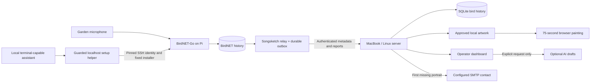

# A small system, with clear jobs

The Pi does recognition locally. Audio stays in BirdNET; Songsketch transfers species, confidence, time, station health and redacted reports. The relay catches up from retained database history after an outage. A stable station/event identity prevents retries inflating history.

The server commits a record before acknowledging it. The display queue is separate from detection history. Fresh qualifying detections with approved animations enter a bounded queue; older replayed records update history without pretending the bird is singing now. A painting takes75 seconds, then rests for20 seconds by default. During idle time the server selects approved local birds with weight `1 + sqrt(monthly detections)`, avoiding an immediate repeat when possible.

A tiny status mark describes what is known: recent detection, monthly history, last heard or local repertoire. BirdNET recognising a vocalisation does not establish continuous singing. The Pi heartbeat separately describes connection, dispatched audio and inference health. Silence is not an equipment failure. If connectivity fails, the display retains its last painting.

The supported first deployment is a trusted home LAN. The public display and minimal status are readable on that LAN. Station ingress requires the station token. Administrator routes require a separate token/session and loopback access with a matching browser origin; the display receives neither secret. No public hosting, TLS reverse proxy or router port forwarding is installed. For a remote mini PC, SSH forwarding makes its dashboard available at localhost without opening administration to the LAN.

Secrets are owner-readable local files, not an encrypted vault. They are excluded from Git, diagnostics and migration ZIPs. HTTP station traffic on the home LAN is not encrypted; use a trusted isolated LAN or a private encrypted tunnel if the network is shared/untrusted. SSH pairing protects configuration transfer.

`GET /events` uses SSE, with periodic state updates and reconnect support. Animation frames are computed locally from retained authored marks and embedded references, not requested from an AI service. Current playback state survives server restart; the display uses its elapsed timestamp when reconnecting.

Automatic care consists of bounded retries, health checks, process supervision, diagnostic grouping, rotating logs, retention and verified SQLite snapshots. An AI explanation never executes shell commands. A server without power cannot send its own warning; the still-powered Pi buffers reports until it returns.

## Setup and recovery are a separate control path

The external local assistant obtains the existing application and uses `scripts/ai-bootstrap.py` to create or reuse a managed app copy, start the supervised server and open the guide through a short-lived, single-use session ticket. The durable administrator credential stays in private configuration. Bootstrap does not install an OS startup service, flash a card or contact the Pi. A normal cloud chat without local tools cannot perform these operations. See [the AI handoff](ai-setup.md).

The HTML guide presents the same state available through `scripts/setup-assistant.py` and the authenticated localhost setup API. `CommissioningManager` accepts fixed probe, trust, install, retry, diagnose and cancel actions; it is not a generic shell endpoint. A new or changed SSH identity requires explicit confirmation. Existing keys/agents or a short-lived local password handle authentication. The bundled Pi helper runs through the approved sudo path, applies only its supported owned configuration and verifies capture, advancing inference, readable history and server delivery. Existing authentication and unmanaged/complex configurations require review instead of being weakened or replaced.

The server saves bounded setup evidence under `commissioning/state.json`. Its `/api/admin/setup-context` combines that state with redacted diagnostics and recovery instructions for a local assistant. A diagnostic operation finishing does not mean the installation passed: `job.commissioned` and `last_successful_install` distinguish successful software commissioning from a completed diagnostic snapshot. Current station health is a separate observation. Interrupted work requires inspection before an explicit retry; cancelling the local SSH connection is not a promise that a remote operation rolled back.

The local assistant may perform bounded, evidence-based repairs using its authorised terminal tools. This is distinct from Songsketch's optional paid AI diagnosis, which returns advice and cannot execute arbitrary repairs. Both retain the same human boundaries: credentials, host trust, destructive storage actions and physical commissioning. No success in this control path establishes audio quality, a genuine bird or unattended reboot/outdoor reliability without those checks on the actual equipment. See [Pi setup](pi-setup.md) and [verification](verification.md).
