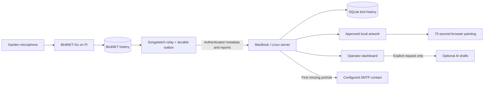

# A small system, with clear jobs

The Pi does recognition locally. Audio stays in BirdNET; Songsketch transfers species, confidence, time, station health and redacted reports. The relay catches up from retained database history after an outage. A stable station/event identity prevents retries inflating history.

The server commits a record before acknowledging it. The display queue is separate from detection history. Fresh qualifying detections with approved animations enter a bounded queue; older replayed records update history without pretending the bird is singing now. A painting takes75 seconds, then rests for20 seconds by default. During idle time the server selects approved local birds with weight `1 + sqrt(monthly detections)`, avoiding an immediate repeat when possible.

A tiny status mark describes what is known: recent detection, monthly history, last heard or local repertoire. BirdNET recognising a vocalisation does not establish continuous singing. The Pi heartbeat separately describes connection, dispatched audio and inference health. Silence is not an equipment failure. If connectivity fails, the display retains its last painting.

The supported first deployment is a trusted home LAN. The public display and minimal status are readable on that LAN. Station ingress requires the station token. Administrator routes require a separate token/session and loopback access with a matching browser origin; the display receives neither secret. No public hosting, TLS reverse proxy or router port forwarding is installed. For a remote mini PC, SSH forwarding makes its dashboard available at localhost without opening administration to the LAN.

Secrets are owner-readable local files, not an encrypted vault. They are excluded from Git, diagnostics and migration ZIPs. HTTP station traffic on the home LAN is not encrypted; use a trusted isolated LAN or a private encrypted tunnel if the network is shared/untrusted. SSH pairing protects configuration transfer.

`GET /events` uses SSE, with periodic state updates and reconnect support. Animation frames are computed locally from retained authored marks and embedded references, not requested from an AI service. Current playback state survives server restart; the display uses its elapsed timestamp when reconnecting.

Automatic care consists of bounded retries, health checks, process supervision, diagnostic grouping, rotating logs, retention and verified SQLite snapshots. An AI explanation never executes shell commands. A server without power cannot send its own warning; the still-powered Pi buffers reports until it returns.
