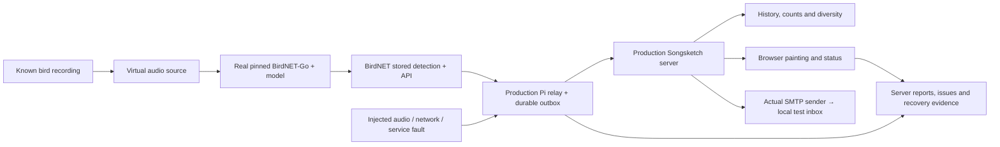

# Release validation: the garden before the garden

**24 October update:** The full branch design is approved. Browser fault reporting and commissioning-capture exclusion are implemented; 285 Python checks, JavaScript playback/report checks and 405 layout assertions pass. An actual 22-check synthetic HTTP rehearsal passes. Local SMTP and restore checks also now exist. Clean-VM installation, broader real-model coverage, the long soak and physical commissioning remain open. Historical audit notes below describe the state at their stated dates.

**Installation audit follow-up, 22 October:** [the hardware/software audit](installation-audit.md) records a fresh 242-test pass and twelve passing isolated HTTP scenarios. It also identifies unimplemented commissioning-test tagging for real microphone detections and automatic browser painting-error upload. Those are handover gaps, not passing simulator features. Physical sealing/thermal acceptance, real SMTP transport, remote access and clean-host restore remain separate gates. The restore CLI currently checks port 8765 even for a separate target directory; an existing server can block an isolated rehearsal.

This is developer-owned testing before handover. It is separate from the illustrated setup journey and the safe Practice Garden. Monty should receive a tested release, then complete only the unavoidable checks on his actual equipment. Do not add a VM, audio corpus, SMTP test server or this matrix to his installation prerequisites.

**Status: partial real-runtime validation, 22 October 2026.** The first actual ARM64 BirdNET audio/API run now passes: settings PATCH/readback, saved settings after restart, advancing inference, Tawny Owl recognition, ten stored detections delivered by the production relay into an isolated real server, and replay deduplication. An empty test catalogue queued one unsent missing-art notice. See [the run, reproducible checks and evidence](birdnet-live-validation.md). This found and fixed a real RFC3339Nano/Python 3.9 health-parser incompatibility. The original audited baseline was commit `5842c15` with 229 checks; current verification is in [verification.md](verification.md). The broader lab matrix is still incomplete. No actual SMTP listener, external inbox, physical microphone or full Pi installation has been verified by this run.

## What must be proved



A species identity is different from a detection's unique record ID. Test both: the scientific species name selects art; the record ID prevents delivery retries from being counted twice. A species absent from our art library can still be a perfectly valid BirdNET detection.

Three paths need separate evidence:

- **Operational fault reports:** Pi relay → durable outbox → server `/api/ingest/reports` → stored report and dashboard issue. Recovery resolves the issue while retaining its history.
- **Missing-art email:** qualifying species without a final portrait → durable `email_outbox` → actual SMTP sender → captured email. A portrait awaiting animation must not produce a missing-portrait email.
- **Browser/painting errors:** a failed asset, rendering exception or preparation timeout should reach server diagnostics, with offline retention. Implemented on 24 October with scoped capabilities, fixed fields, durable bounded retry and real HTTP regression checks; see [display recovery](display-recovery.md). Downloadable QA JSON is not a replacement for it.

## Four test layers

| Layer | Run and purpose | What it cannot certify |
| --- | --- | --- |
| Fast checks, already present | Existing macOS/Ubuntu CI, package hashes, unit tests, real loopback relay/server integration and privacy tests | Real recognition, an actual SMTP exchange or physical commissioning |
| Full application lab, to build | Real server, real relay, deterministic BirdNET API fixture, real local SMTP capture, browser and fault injection | Actual model accuracy or physical capture |
| Real recogniser smoke test run; virtual installation to build | Same pinned ARM64 BirdNET-Go/model, recorded audio fed into its normal live pipeline, actual stored detections/API, relay and server; separate clean-VM installation/service tests | USB microphone quality, Pi firmware/power, SD-card behaviour, Wi-Fi range and enclosure conditions |
| Physical acceptance | Actual kit, microphone, power and network; one real bird, reboot/reconnect, long-running display, final host and configured mail provider | No finite test guarantees all future failures; retain diagnostics and bounded recovery |

The Practice Garden remains a quick demonstration with synthetic inputs and an inbox that bypasses SMTP. The full application lab must use the production sender so that a green inbox result means an SMTP conversation really happened.

## How the virtual station should hear

Use a disposable Linux ARM64 environment, running the same BirdNET-Go `20261014` image and BirdNET v2.4 model as the installation. The source tag was resolved during this audit to commit `9642f74f3b2717ca6a6b653239f7f03cf6faa66f`; that source commit is not a container-image digest. Resolve and record the actual image digest and model identity; never silently substitute `latest`. Reuse the actual `pi/relay.py` and Songsketch server. Do not replace the recogniser's result with an injected success. Recognition runs locally and needs no paid AI API key.

For the first real-recognition test, publish a known recording at real-time speed through a local RTSP source and let BirdNET's ordinary live pipeline process it. Upstream already has a MediaMTX/FFmpeg stream-test fixture. This path exercises decoding, analysis, filtering, detection persistence and the same API the relay polls. A WAV appearing in a container, a loaded model or a healthy HTTP endpoint is not sufficient evidence.

Do not rely on an old `birdnet-go file recording.wav` example. The pinned root command no longer registers the old file-analysis command despite retained older documentation. Even if another analysis tool outputs a label, that would not prove the live database/API integration.

Use a small versioned audio corpus: several common Dorset species including at least one owl, silence, ambient garden noise and speech/non-bird audio, then mixed and noisier variants. Each fixture needs its source/licence, SHA256, expected scientific species where known, sample rate, channels, duration and any transformations. Record season/location filters, minimum confidence, quiet-hour settings and model configuration. Evaluate outputs rather than adjusting labels to manufacture a pass. Non-bird clips test a measured false-positive baseline; do not assume a classifier can never report a false positive.

One clip may create multiple stored detections, or none after filtering. Compare Songsketch's history with the qualifying unique records actually returned by BirdNET, not an assumption that each playback equals exactly one bird. Keep distinct recognition-quality results and transport-integrity results.

For the real-recognition missing-art case, replay the same reliable clip while an **isolated lab catalogue** omits that species's art. Repeat with its final portrait present but animation absent. This tests both branches without altering the approved library or needing an unusually rare recording.

For installation/reboot checks, use a clean Debian 12/13 ARM64 VM with real SSH and systemd. Test reusable software provisioning and service operations there. The current production installer intentionally requires a Raspberry Pi hardware marker and ALSA capture device, and its USB commissioning path rejects existing RTSP streams. Keep those guards. Build an explicitly separate lab provisioning profile that shares the relevant implementation; do not spoof `/proc/device-tree/model`, weaken the real installer or claim a generic VM passed Pi-only commissioning. An ALSA loopback device in a suitable guest kernel can later exercise the capture path; it still cannot certify the real microphone.

This is a virtual Linux station with the Pi's software architecture, not a faithful Pi 5 emulator. QEMU's documented Raspberry Pi boards currently stop at Pi 4 and have peripheral gaps. The actual power helper, USB behaviour and final production power chain remain physical checks.

## Coverage and acceptance matrix

“Existing” below describes the kind of evidence available, not a newly executed test. Planned cases must stay pending until a saved run proves their assertions.

| ID | Scenario and required assertion | Current evidence / next work |
| --- | --- | --- |
| S01 | Known species → one durable unique observation, correct art, correct queue and dashboard | Real relay/HTTP/store with fixture BirdNET: `PipelineTests.test_real_receiver_normalization_counts_and_missing_art`; repeat against actual model |
| S02 | Duplicate message, lost acknowledgement and retry → no duplicate count or queued painting | Existing integration tests; repeat under injected latency/connection reset |
| S03 | Wrong acknowledgement ID, missing ID or malformed success → retain queued payload | **Implementation gap:** `Relay.deliver` currently checks ID presence, not equality; add regression and fix before lab sign-off |
| S04 | Low confidence, malformed identity/time, wrong station/token, oversized input → documented rejection or non-qualifying history, no partial side effects | Existing server validation/security tests; include each in full lab |
| S05 | Valid species with no portrait → stored observation, last working painting retained, one pending notice per species | Existing store/registry tests; add real HTTP + browser + SMTP assertion |
| S06 | Final portrait exists, animation absent → history/dashboard identify missing animation, no missing-portrait email, no invalid playback | Existing reference-art tests; add full lab assertion |
| S07 | Burst, display cooldown, repeated species and out-of-order/old observations → correct history and queue independent of delivery retries | Existing store/relay coverage; add bounded load/backlog run |
| S08 | Month boundary/DST, date filters, CSV export, diversity and idle weighting → counts reconcile with qualifying events | Existing monthly boundary/summary logic; add API/browser/export cross-checks and deterministic statistical checks for weighting |
| S09 | Unknown artwork mapping or tampered/missing asset → no false “ready” state; retain valid painting and actionable diagnostic | Hash/registry tests exist; browser-upload part pending |
| R01 | Audio or inference fails with no birds → report uploaded and visible under correct component; silence alone is healthy | Real relay/server with fixture health: `test_health_and_recovery_reports_with_no_bird_activity`; repeat with stopped real stream/model |
| R02 | Server offline → fault/detection queues persist; restart relay and server → all pending items arrive once | Existing detection replay and separate report-unit coverage; add one combined report-specific round trip |
| R03 | Server commits report but response is lost → retry acknowledges the same report, one issue/history entry | Add report-specific lost-ack integration case |
| R04 | Repeated fault → grouped/rate-limited reports; fresh healthy evidence resolves issue without deleting history | Existing relay/server tests; verify real interrupted/restored stream |
| R05 | Heartbeat missing vs microphone failed vs inference failed → distinct state; old buffered heartbeat never implies live listening | Existing relay/server health tests; assert browser symbols and dashboard together |
| R06 | Browser asset exception, iframe error, load timeout and unhandled rejection → bounded redacted report queue, eventual upload and visible issue | **Implementation gap:** design scoped display reporting, offline retention and rate limits; never expose station/admin credentials to public display |
| R07 | Server unreachable while reviewing a bug → downloadable last-known report with timestamp/version and no claimed fresh result | Offline QA helper tests and manual browser evidence exist; add browser regression case |
| E01 | First missing-art notice crosses actual SMTP, captured envelope/body match species and no credentials leak | **Gap:** current mail tests mock `smtplib`; add Mailpit/local SMTP fixture using unchanged `Maintenance.send_mail` |
| E02 | Repeated species, sender restart and duplicate detection → one normal alert; an added final portrait resolves only unsent matching notice | Store/mock coverage exists; verify captured SMTP messages and durable state |
| E03 | SMTP refusal, DNS/connect failure and recovery → bounded retry with recorded error, no dropped history | Mock coverage exists; add controlled SMTP faults |
| E04 | Connection dies during submission → explicitly uncertain delivery, no automatic duplicate send | Mock coverage exists; add SMTP fault at DATA/ack boundary; do not promise exactly-once external email |
| E05 | TLS/auth failure → clear error; correct controlled configuration succeeds | Add local certificate/auth fixture; do not disable certificate verification to pass |
| E06 | Actual configured mail provider delivers to intended inbox | Final explicitly authorised commissioning message; local SMTP capture cannot prove provider delivery |
| B01 | Clean known clip → real model output, stored detection, API row, relay payload, server history and correct painting can be traced | **Partial:** real owl audio → ten stored records → production relay → isolated real server passed; rendering and a broader clip corpus remain |
| B02 | Silence/non-bird clips → processing remains healthy; measured detections/false positives recorded | Not run; keep microphone health separate from bird activity |
| B03 | Noisy/mixed/quiet recordings, repeated and owl clips → measured recognition/confidence under recorded filters | **Partial:** repeated upstream Tawny Owl clip recognised with recorded settings; noisy/mixed/other-species corpus not run |
| B04 | RTSP interruption, decoder error, model failure and recovery → correct health/report/retry behaviour | Not run against actual BirdNET; fixture responses currently cover contracts only |
| B05 | Recorded response schema, pagination, model/source IDs and timestamps match our parser | **Partial:** actual API shapes, settings writes/readback, ten detection records and RFC3339Nano health verified; timestamp regression added. Large real-data pagination and optional multi-source mapping remain |
| B06 | Wrong or expired BirdNET access credential → unknown/failed health reported; no false healthy state | Mock/error cases exist; controlled real-auth test needed for that deployment mode |
| I01 | Clean virtual install → real SSH/software/service operations complete with saved evidence and no hand-written code | Guarded transport/commissioning mostly mocked; build explicit lab provisioner and keep Pi-only gates pending |
| I02 | Rerun, partially failed install, occupied port and existing configuration → reuse/preserve or stop clearly; no competing processes | Existing bootstrap/commissioning fixtures plus local process tests; repeat in clean/restored VM |
| I03 | Reboot guest, restart BirdNET/relay/server in different orders → service recovery and pending work preserved | Real server process recovery exists; VM service/reboot tests pending |
| I04 | No keys → routine listening/playback/recovery works; paid AI remains explicit and bounded | AI/mock tests exist; assert no external requests during full lab/soak |
| I05 | Authorised optional AI job fails/is interrupted → no silent paid retry, no overwrite of approved artwork | Mock coverage; a real paid-provider smoke test is optional and separately authorised |
| D01 | Backup/export → execute restore into fresh runtime → restart → compare history, queues, settings and approved custom art; re-enter secrets | Backup/export tested; **no restore-helper round trip yet** |
| D02 | Corrupt/traversal archive or interrupted restore → original state preserved or valid rollback available | Add real restore-helper negative tests, confined to disposable directories |
| D03 | Disk quota/full/read-only storage → checkpoints do not advance over lost work; fault is visible where storage remains available | Some relay guards exist; inject filesystem faults only in a bounded lab volume |
| D04 | Kill owned server during load → bounded recovery, no foreign process stopped, history persists | Existing real-process supervisor test; repeat with relay/browser load |
| D05 | Sustained run → no unbounded queue/log/memory growth; repeated offline/recovery cycles reconcile all accepted records | Proposed minimum 24-hour pre-handover soak; 48-hour production rehearsal; run asynchronously with explicit resource/size caps |
| V01 | Cold/warm painting, next bird mid-drawing, tab background/resume, reload and two clients → understandable state and correct final frame | Some manual evidence only; add repeatable browser checks and per-device performance measurements |
| V02 | All 45 animations → final-art comparison, full duration, even progress and correct status geometry | Full branch collection visually approved on 24 October; final-screen performance and fidelity remain physical commissioning checks |
| V03 | Cold preparation → measure lost opening time and final-frame completion in connected display | Known limitation: live clock can advance while preparing; resolve or explicitly accept before production promotion |
| X01 | Public display contains no administrator/station secrets; cross-origin and unauthorised changes rejected | Existing HTTP tests; verify full browser/network/report/SMTP evidence |
| X02 | Package from GitHub/offline ZIP → all dependencies local, no developer absolute paths, no runtime data or secrets included | Package/hash tests and extracted archive checks exist; repeat as a release gate |
| P01 | Actual USB capture/gain, real bird, Pi reboot, Wi-Fi, Mac sleep/lid and later mini-PC boot | Physical-only acceptance, still pending |
| P02 | Production power/current limits, undervoltage, thermal behaviour and outdoor enclosure | Physical-only; diagnostic fixtures cannot prove electrical safety or weather protection |

## Lab boundaries and reproducibility

- Keep all test databases, station identities, tokens, ports, container names and mail recipients separate from the real garden. Never attach the live runtime directory or use Monty's real inbox for routine tests.
- Bind test interfaces to loopback or an isolated guest network. The SMTP capture server must have forwarding/releasing disabled. Initial image/model/fixture downloads can need internet; routine lab execution must not accidentally publish detections to BirdWeather, MQTT, external mail or paid AI services.
- Fault injection targets only lab-owned processes, streams and bounded volumes. Stop by verified ownership; never kill whatever happens to be on a port or fill the host disk. Preserve the failed run's evidence before cleanup.
- Real audio cases cannot use the server's `test:true` shortcut as their only assertion: exercise qualifying detection history in the isolated database, and label the entire environment synthetic. Nothing merges into live history.
- Snapshot the clean VM before the install test. Record the exact shared code exercised and skipped Pi-only checks. No fake successful hardware markers.
- Use actual configured retry/cooldown/heartbeat periods, with bounded phase-specific deadlines. Fast fixture-clock tests and real elapsed-time tests must be labelled separately.

Each run should produce a private evidence bundle: case ID, pass/fail/blocked/skipped, code commit/release, image digest, guest OS/architecture, model identity, fixture hashes, relevant configuration without secrets, start/end times, expected/observed assertions, detection/report/SMTP message IDs, redacted logs and browser screenshots where relevant. Retain failed runs and link related GitHub issues; never turn a missing dependency, skipped model or unconfigured inbox into a green check.

## Implementation order and release gate

1. Fix acknowledgement-ID matching and define/implement bounded browser fault reporting with regression coverage.
2. Build the full application harness with local SMTP, report outage/restart tests and actual restore round trips. Preserve the Practice Garden's no-external-action boundary.
3. Add the pinned real BirdNET/recorded-audio lane, beginning with one reliable clip and one real stored detection, then expand the corpus and fault cases.
4. Add clean-VM software installation/reboot tests and a sustained run. Publish a concise coverage/evidence report for the release.
5. Commission the actual hardware and intended email provider. Those results belong to the installation, not to the generic release.

Before claiming “software handover validated”, all required software cases must have evidence or an explicit reviewed exception; known data-loss, restore and diagnostic gaps cannot be hidden by passing unrelated tests. “Hardware commissioned” is a separate status. This plan does not yet claim either expanded gate has passed.

The existing quick checks remain:

```sh
python3 scripts/check-install.py
python3 -m unittest discover -s tests -v
python3 -m unittest discover -s artwork/tools -p 'test_*.py' -v
node --test tests/test_qa_report.js
```

There is deliberately no invented command for the unbuilt virtual-station harness. Its eventual one-command launch belongs to developer QA, not to the illustrated installer.

## Primary references and code evidence

- [Pinned BirdNET-Go command registration](https://github.com/tphakala/birdnet-go/blob/20261014/cmd/root.go) and [configuration defaults](https://github.com/tphakala/birdnet-go/blob/20261014/internal/conf/config.yaml).
- [Pinned live command](https://github.com/tphakala/birdnet-go/blob/20261014/cmd/serve/serve.go) and [detection pipeline](https://github.com/tphakala/birdnet-go/blob/20261014/doc/wiki/detection-pipeline.md). The audit read the pinned source directly when the browser cache could not fetch GitHub's HTML pages.
- [Pinned upstream MediaMTX/FFmpeg stream fixture](https://github.com/tphakala/birdnet-go/blob/20261014/internal/audiocore/streamtest/fixture_mediamtx.go) and [container fixture](https://github.com/tphakala/birdnet-go/blob/20261014/internal/testutil/containers/mediamtx.go).
- [Mailpit SMTP capture, API and fault testing](https://mailpit.axllent.org/docs/).
- [Lima Linux VM documentation](https://lima-vm.io/docs/) and [QEMU Raspberry Pi board/peripheral limits](https://www.qemu.org/docs/master/system/arm/raspi.html).
- Existing Songsketch evidence: `tests/test_integration.py`, `tests/test_pi.py`, `tests/test_server.py`, `tests/test_reference_art_availability.py`, `tests/test_jobs.py`, `tests/test_setup_integration.py`, `tests/test_supervisor.py`, `tests/test_simulation.py` and [verification.md](verification.md).
- Audited gaps: `pi/relay.py::Relay.deliver`, `static/display.js`, `scripts/restore.py`, `scripts/install-pi.sh` and `scripts/commission-pi.py`. Source review is not execution evidence.

## Local extension — 23 October 2026

`tests/test_smtp_capture.py` now exercises actual loopback SMTP delivery, duplicate suppression, recipient refusal/recovery and a lost DATA acknowledgement (uncertain, no automatic resend). External provider receipt and TLS/auth remain unverified. `tests/test_restore_roundtrip.py` runs the actual restore CLI with valid history/custom-art fixtures, restart, credential preservation, held runtime lock, hostile archive paths and injected-copy rollback. The restore helper now uses its target directory lock independently of port and validates before replacement. This narrows E01–E04 and D01–D02; it does not close the broader release gate. See [remaining-work.md](remaining-work.md).
